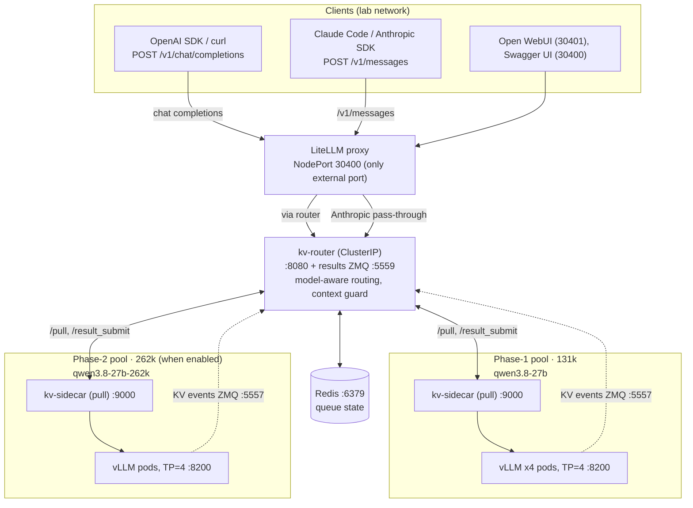

# SIR LLM Platform

Self-hosted LLM serving: **Qwen3.8-27B** on **Huawei Ascend 910B NPUs** —
**vLLM** + KV-aware router + **LiteLLM** gateway, Prometheus/Grafana
monitoring. Client how-tos:
[claude-code](claude-code/README.md) · [pi](pi/README.md) ·
[deepseek-harness](deepseek-harness/README.md) ·
[monitoring](monitoring/README.md).

## Models & pools

Same weights, two hardware pools. The `model` field in the request body picks
the pool — one base URL on both API paths.

| Model name | Pool | Context |
|------------|------|---------|
| `qwen3.8-27b` | phase-1 (4 pods × TP=4, 910B) | 131,072 — default |
| `qwen3.8-27b-262k` | phase-2 (910B3 64 GB HBM) | 262,144 — long context, off by default |
| `qwen3.8-27b-131k` | phase-1 alias | 131,072 — OpenAI path only |

## Architecture

[**🖼 Architecture diagram — two deployments, one gateway**](docs/architecture.png)
(PNG; editable source: [docs/architecture.svg](docs/architecture.svg))



## Quick start

- **Base URL** — `http://7.242.101.107:30400` (any cluster node IP works)
  - OpenAI (`/v1/chat/completions`): `http://7.242.101.107:30400/v1`
  - Anthropic (`/v1/messages`): `http://7.242.101.107:30400`
- **API key** — apply at `http://7.242.101.107:30410/keys`, then contact
  **Sheriffo (s00628324)** to approve your key
- **Pool** — picked by the `model` field: `qwen3.8-27b` (131k, default) · `qwen3.8-27b-262k` (262k)
- **Verify**:

```bash
curl -s http://7.242.101.107:30400/v1/chat/completions \
  -H "Authorization: Bearer YOUR-API-KEY" -H "Content-Type: application/json" \
  -d '{"model":"qwen3.8-27b","messages":[{"role":"user","content":"Reply with PONG"}],"max_tokens":20}'
```

### Claude Code

- **Setup** (back up any existing settings first; replace `YOUR-API-KEY`):

```bash
cp claude-code/settings.qwen3-8b.json ~/.claude/settings.json
claude -p "Reply with PONG"                                     # verify
```

- **Full `~/.claude/settings.json`**:

```json
{
  "env": {
    "DISABLE_TELEMETRY": "1",
    "DISABLE_ERROR_REPORTING": "1",
    "CLAUDE_CODE_DISABLE_NONESSENTIAL_TRAFFIC": "1",
    "MCP_TIMEOUT": "60000",
    "ANTHROPIC_API_KEY": "YOUR-API-KEY",
    "ANTHROPIC_BASE_URL": "http://7.242.101.107:30400",
    "ANTHROPIC_MODEL": "qwen3.8-27b",
    "ANTHROPIC_DEFAULT_HAIKU_MODEL": "qwen3.8-27b",
    "ANTHROPIC_DEFAULT_SONNET_MODEL": "qwen3.8-27b-262k",
    "ANTHROPIC_DEFAULT_OPUS_MODEL": "qwen3.8-27b",
    "ANTHROPIC_SMALL_FAST_MODEL": "qwen3.8-27b",
    "CLAUDE_CODE_DISABLE_1M_CONTEXT": "1",
    "CLAUDE_CODE_AUTO_COMPACT_WINDOW": "131072",
    "CLAUDE_CODE_MAX_OUTPUT_TOKENS": "8192",
    "HTTP_PROXY": "http://127.0.0.1:3128",
    "HTTPS_PROXY": "http://127.0.0.1:3128",
    "http_proxy": "http://127.0.0.1:3128",
    "https_proxy": "http://127.0.0.1:3128",
    "NO_PROXY": "127.0.0.1,127.0.0.*,localhost,*.huawei.com,7.242.101.107"
  },
  "model": "sonnet",
  "enabledPlugins": {
    "cc-demo-plugin@rtos-cc-marketplace": true
  },
  "outputStyle": "engineer-professional",
  "skipWebFetchPreflight": true,
  "theme": "dark"
}
```

- `CLAUDE_CODE_AUTO_COMPACT_WINDOW: 131072` is **required** — without it,
  long sessions die with `500 … maximum context length is 131072`; raise to
  `240000` to use the full 262k window (env read at session start)
- `"model": "sonnet"` pins the session to the 262k pool; everything else
  stays 131k (pin `"qwen3.8-27b"` to force 131k)
- `*_PROXY` lines + `enabledPlugins` are workstation-specific — drop if
  your machine reaches the cluster directly

### pi

- **Setup** (merge the `sirlab` entry if `models.json` already has providers):

```bash
mkdir -p ~/.pi/agent
cp pi/models.json    ~/.pi/agent/models.json
cp pi/settings.json  ~/.pi/agent/settings.json
pi --list-models qwen      # should list sirlab / qwen3.8-27b
pi -p "Reply with PONG"    # verify
```

- **Full `~/.pi/agent/models.json`** (replace `YOUR-API-KEY`):

```json
{
  "providers": {
    "sirlab": {
      "baseUrl": "http://7.242.101.107:30400/v1",
      "api": "openai-completions",
      "apiKey": "YOUR-API-KEY",
      "compat": {
        "supportsReasoningEffort": false,
        "thinkingFormat": "qwen-chat-template"
      },
      "models": [
        {
          "id": "qwen3.8-27b",
          "name": "Qwen3.8 27B",
          "reasoning": true,
          "input": ["text", "image"],
          "contextWindow": 131072,
          "maxTokens": 8192
        },
        {
          "id": "qwen3.8-27b-131k",
          "name": "Qwen3.8 27B (131k context, 32G pool)",
          "reasoning": true,
          "input": ["text", "image"],
          "contextWindow": 131072,
          "maxTokens": 8192
        },
        {
          "id": "qwen3.8-27b-262k",
          "name": "Qwen3.8 27B (262k context, 64G pool)",
          "reasoning": true,
          "input": ["text", "image"],
          "contextWindow": 262144,
          "maxTokens": 8192
        }
      ]
    }
  }
}
```

- **Full `~/.pi/agent/settings.json`**:

```json
{
  "defaultProvider": "sirlab",
  "defaultModel": "qwen3.8-27b-131k",
  "enableInstallTelemetry": false,
  "theme": "dark",
  "quietStartup": true,
  "compaction": {
    "enabled": true,
    "reserveTokens": 32768,
    "keepRecentTokens": 20000
  },
  "defaultThinkingLevel": "high"
}
```

- don't raise `maxTokens: 8192` — pi's input wall is
  `contextWindow − maxTokens`
- compaction triggers at ~98k → sessions run to ~122k input (262k pool:
  ~254k) and compact cleanly instead of failing with `prompt is too long`
- `models.json` is reloaded when you open `/model` — live-edit, no restart

## API keys (per-user)

Everyone gets their own LiteLLM **virtual key** — no more one shared lab key.
Managed in the **npu-ops** dashboard, **API keys** tab:
**`http://7.242.101.107:30410/keys`**.

1. **Request** — fill in your Huawei ID / username (no spaces — it becomes the
   key's `user_id`), full name, team, and optionally restrict the key to
   specific models (`qwen3.8-27b`, `-131k`, `-262k`). No login needed.
2. **Approve** — an admin approves pending requests (⚙️ admin login, bottom
   right). On approval the key is generated in LiteLLM and shown **once** in
   a modal — copy it then; afterwards only its hash is kept.
3. **Use it** — wherever the shared key used to go: `Authorization: Bearer
   <key>` against `http://7.242.101.107:30400/v1` (OpenAI) or `:30400`
   (Anthropic `/v1/messages`) — i.e. replace the key in
   `models.json` / `settings.json` / SDK clients.
4. **Track / revoke** — "track your keys" on the same page (by Huawei ID, no
   login) shows request counts, token counts and last active per key; an
   admin blocks a key with one click. Per-key usage is read straight from
   LiteLLM's Postgres. Full spec (auth model, password rotation, REST API):
   [`npu-ops/README.md`](npu-ops/README.md).

The shared master key (`litellm.masterKey` in `vllm-stack/values.yaml`)
remains valid for admin/infra (LiteLLM
admin UI, monitoring service monitors, chart defaults).

## Who is sending requests (LiteLLM observability)

With per-user virtual keys (above), the LiteLLM admin UI attributes every
request to its owner. For shared/legacy clients on the master key, attribution
comes from source IP + user-agent, captured per request in two places:

- **Grafana** — `http://7.242.101.107:30300/d/sir-llm-platform-vllm`, row
  **Client requests (LiteLLM gateway)**: rate by IP × agent, per-agent rate,
  requests by IP × status code, failures by client, 24h totals per client,
  token throughput per model. `client_ip` is the pod IP for in-cluster
  clients — map it back with `kubectl get pods -A -o wide | grep <ip>`.
- **CLI (no browser)** — `python3 scripts/track-requests.py [--since 2h | --tail]`
  summarizes the gateway's access log by client IP, with a live-tail mode.
- **LiteLLM admin UI** — `http://7.242.101.107:30400/ui`, login `admin` /
  the shared master key. The **Requests** page shows every request with
  requester IP, user-agent, model, tokens, cost and status; **Spend** tracks
  totals. Backed by the Postgres deployed with the stack
  (`vllm-stack/templates/10-postgres.yaml`, static local PV on the
  control-plane node). One-time step before the first deploy: create
  `/data/litellm-db` on the control-plane node (local PVs don't create the
  path). Note: `allow_requests_on_db_unavailable: false` — while Postgres is
  down the gateway refuses LLM requests rather than serving untracked.

For services that must share a key, give each client/service its own
User-Agent; individual users should just use their own virtual key (above),
which is the cleanest attribution.

---

Internal use only — Clyde Org
